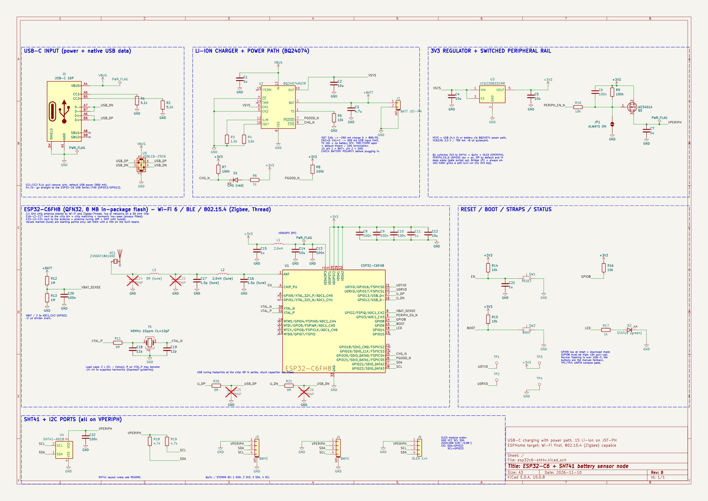
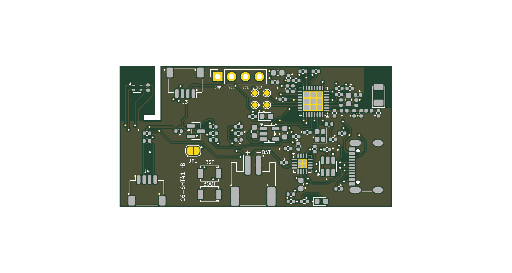

# ESP32-C6 + SHT41 battery sensor node

A small battery-powered temperature/humidity node built around the bare
ESP32-C6 chip, meant to run ESPHome over Wi-Fi now and Zigbee (802.15.4) later.

**Status: schematic and PCB layout, revision B** (revision A plus the changes
from a design review, listed under "Revision B changes"). Nothing has been
built or tested. The layout passes KiCad's design rules check but was routed
by script and needs a human review before ordering (see below).



| File | What it is |
|---|---|
| `hardware/esp32c6-sht4x.kicad_pro` | KiCad 10 project (open this) |
| `hardware/esp32c6-sht4x.kicad_sch` | Schematic, saved by KiCad 10.0.8 |
| `hardware/esp32c6-sht4x.kicad_pcb` | PCB layout, 4 layers, 50 x 26 mm |
| `hardware/lib/esp32c6-sht4x.kicad_sym` | Project symbol for the ESP32-C6FH8 |
| `docs/schematic.pdf` | Printable schematic |
| `docs/bom.csv` | Bill of materials exported from the schematic |
| `docs/erc.rpt` | KiCad electrical rules check report (0 violations) |
| `docs/drc.rpt` | KiCad design rules check report for the PCB (0 violations, 0 unconnected, schematic parity clean) |
| `docs/pcb-*.png` | Renders of the board and its outer copper layers |
| `tools/` | The Python scripts that generated the schematic and the layout (reference only, paths are specific to the machine they ran on) |

## What is on the board

| Block | Part | Notes |
|---|---|---|
| MCU | ESP32-C6FH8 (QFN32) | Bare chip, 8 MB in-package flash, Wi-Fi 6 + BLE + 802.15.4. 40 MHz crystal. The 4 MB ESP32-C6FH4 is a drop-in alternative. |
| Antenna | Johanson 2450AT18A100E chip antenna | One 2.4 GHz antenna serves Wi-Fi and Zigbee/Thread. Two pi networks on the 50 ohm feed: C16-L2-C17 at the chip pin (chip matching and harmonic filter, fitted) and C23-L3-C24 at the antenna (antenna tuning, 0R and not-fitted until tuned). |
| USB | USB-C 16-pin receptacle | 5.1 k on CC1/CC2, D+/D- to the chip's native USB Serial/JTAG (GPIO13/GPIO12) for flashing and logs, USBLC6-2 ESD protection. |
| Charger | TI BQ24074 | 1-cell Li-ion/LiPo charger with power path: the board runs from USB while the battery charges, and from the battery otherwise. |
| Regulator | XC6220B331MR | 3.3 V, 700 mA, about 8 uA quiescent current. |
| Sensor | Sensirion SHT41-AD1B | I2C address 0x44. |
| I2C ports | 2 x JST-SH 4-pin (Qwiic / STEMMA QT) | Pin 1 GND, 2 3V3, 3 SDA, 4 SCL. |
| OLED | 1x4 2.54 mm socket | GND, VCC, SCL, SDA: the order used by common 0.91"/0.96" SSD1306 modules. |
| Battery | JST-PH 2-pin, side entry | Pin 1 BAT+, pin 2 GND. |
| Controls | RESET and BOOT buttons, status LED, charge LED | |

### Switched peripheral rail

The SHT41, both Qwiic ports, the OLED header and the I2C pull-ups sit on
`VPERIPH`, which is 3V3 behind a P-channel MOSFET (Q1). The firmware turns it
on by driving GPIO3 low. It is off at power-up and during deep sleep, so
add-on boards with power LEDs do not drain the battery while the node sleeps.
Bridging solder jumper JP1 makes the rail permanently on.

## GPIO map

| GPIO | Function |
|---|---|
| 2 | Battery voltage, VBAT / 2 (ADC1_CH2) |
| 3 | `PERIPH_EN_N`, low = peripheral rail on |
| 8 | Strapping pin, 10 k pull-up |
| 9 | BOOT button (low at reset = download mode) |
| 12 / 13 | USB D- / D+ |
| 14 | Status LED, active high |
| 16 / 17 | UART0 TX / RX on test pads TP1 / TP2 |
| 20 | `CHG_N`, low while charging |
| 21 | `PGOOD_N`, low while USB power is present |
| 22 / 23 | I2C SDA / SCL |
| 0, 1, 4-7, 15, 18, 19 | Unused |

## Charger settings

- Charge current is set by R4: I = 890 / R4. 3.6 k gives about 250 mA, which is
  safe for cells of 250 mAh and up. Use 1.8 k for about 500 mA with larger cells.
- EN2 low and EN1 high select the 500 mA USB input limit. R3 (ILIM) is only
  used if that mode is changed.
- TS has a fixed 10 k resistor because a 2-pin battery has no thermistor.
- TMR and ITERM are left open for the default safety timers and 10 %
  termination current.

## PCB layout



- 50 x 26 mm, 4 layers, 1.6 mm. Layer 2 is a solid ground plane, layer 3 is a
  3V3 plane, and both outer layers carry signals with ground pours.
- All parts are on the top side. 0.15 mm tracks and clearances, 0.5/0.3 mm
  vias, which fits standard 4-layer services.
- The SHT41 sits alone on a peninsula in the top-left corner, cut off by a
  1 mm slot on two sides. There is no copper pour on any layer there, and the
  only copper crossing the 4.5 mm bridge is four 0.15 mm traces.
- The chip antenna is in the top-right corner with all four copper layers
  cleared around it (5.2 x 7.75 mm). The ground edge now sits right below the
  antenna feed pad, so the 0.35 mm feed runs over the layer-2 ground plane for
  all but its last 0.35 mm. Nothing is routed on the bottom layer under the
  RF chain.
- Both crystal traces are on the top layer only, with solid ground on layers
  2 and 4 underneath and no signals or vias under the crystal.
- USB D+/D- run as one 0.2 mm / 0.16 mm gap pair on the bottom layer from the
  connector, past the ESD part, to series footprints at the chip.
- USB-C is on the right edge, the battery connector on the bottom edge, one
  Qwiic port on the top edge and one on the bottom edge, and the OLED socket
  along the top edge.
- The charger and regulator, the warm parts, are about 30 mm from the sensor.

### Review this before ordering

The layout was placed by hand and routed by a script, then checked with
KiCad's DRC. DRC only proves the copper is connected and spaced correctly.
A person should still look at:

- **Stackup.** No fab stackup is chosen yet. The 0.35 mm RF feed and the
  0.2/0.16 mm USB pair assume roughly 0.2 mm of prepreg between the outer and
  inner layers (for example JLCPCB's JLC04161H-7628). Recalculate both for
  the real stackup.
- **Antenna geometry.** The antenna position and clearance were not checked
  against Johanson's mounting drawing for the 2450AT18A100E (the datasheet
  could not be opened while designing). Compare before ordering.
- **RF values.** C16/L2/C17 (1.5 pF / 2.0 nH / 1.5 pF) are placeholders so
  the board is not built with an open filter. They and C23/L3/C24 must be
  set with a network analyser on the built board.
- **USB pair.** The two lines separate for about 2 mm at the chip-side vias
  and widen to 0.6 mm pitch for 3 mm beside the ESD part. The pair references
  the 3V3 plane on the bottom layer.
- **EN.** The pull-up and capacitor are now 2.5 mm from the pin, but the
  branch to the reset button is still about 35 mm long because the button is
  on the other side of the board.
- **Trace aesthetics and return paths.** The autorouted traces are valid but
  not tidy, and some signals cross the board on the bottom layer.
- **Decoupling.** Several ESP32-C6 supply pins reach their capacitors through
  the 3V3 plane rather than by a direct trace.
- **No mounting holes** and no fiducials yet.
- Footprints are the stock KiCad ones and have not been checked against the
  exact parts in the BOM.

### Revision B changes

Made in response to a review of revision A:

1. RF: chip-side pi network is now fitted, and a separate antenna tuning pi
   (C23, L3, C24) was added next to the antenna.
2. Antenna feed: ground boundary moved up to the feed pad, so the feed is over
   ground almost to the antenna. The antenna clearance itself is kept.
3. Regulator: 10 uF input (C4) and 10 uF output (C5) capacitors sit directly
   at the VIN, VOUT and GND pins with 0.4 mm traces.
4. RF supply: pins 2/3 leave on a 0.3 mm trace, C13 (100 nF) and C14 (now
   10 uF) are after L1, and the 1 uF (C15) is before it. The ESP32-C6 exposed
   pad has 9 ground vias, the charger pad has 4.
5. Crystal: both legs on the top layer with no vias, R11 stays as the series
   tuning position, nothing routed underneath.
6. USB: routed as a pair, 2 vias per line instead of 5 and 2, about 34 mm
   per line, ground vias at the layer changes, and 0R series (R20, R21) plus
   not-fitted shunt capacitor (C25, C26) footprints at the chip.
7. EN: R14 and C21 moved next to the pin, with the reset button as a branch.
8. The BOM has a Spec column with dielectric, voltage and tolerance.
9. The status LED and its resistor moved next to the test points.

## SHT41 layout rules

These follow Sensirion's SHT4x design-in guidance and are what keeps the
reading at ambient rather than at board temperature.

1. Put the SHT41 in a corner or on a tab at the board edge, as far as possible
   from the ESP32-C6, the BQ24074, the regulator and the charge LED. Put the
   heat sources at the opposite end.
2. Mill a slot (about 1 mm wide) around the sensor so it sits on a small
   peninsula connected by a narrow bridge.
3. No copper pour on any layer under or around the sensor inside the slot. Cut
   the ground plane out there.
4. Route VDD, GND, SDA and SCL over the bridge as thin traces (0.15 mm or less).
   No vias under the part.
5. Keep C22 (100 nF) next to the sensor's VDD pin, on the peninsula.
6. If the board is mounted vertically, the sensor goes at the bottom so warm
   air from the other parts rises away from it.
7. The enclosure needs an opening right at the sensor, with the sensor's air
   volume sealed from the warm interior where possible.
8. Use no-clean solder paste and do not wash, coat or pot the sensor. Keep the
   opening on top of the package free of flux and dust.
9. In firmware, keep the node asleep between readings and measure soon after
   wake-up, before the radio has warmed the board.

Other layout notes: keep the antenna at a board edge with the keep-out from the
Johanson datasheet and no copper under it, keep the antenna and the sensor at
opposite ends, route the RF trace as 50 ohm, keep the crystal close to the chip,
and place all connectors (USB-C, battery, Qwiic) on board edges.

## ESPHome starting point

Untested until hardware exists.

```yaml
esp32:
  board: esp32-c6-devkitc-1
  variant: esp32c6
  flash_size: 8MB
  framework:
    type: esp-idf

switch:
  - platform: gpio            # peripheral rail (SHT41, Qwiic, OLED)
    id: periph_power
    pin:
      number: GPIO3
      inverted: true
    restore_mode: ALWAYS_ON

i2c:
  sda: GPIO22
  scl: GPIO23
  scan: false

sensor:
  - platform: sht4x
    temperature:
      name: Temperature
    humidity:
      name: Humidity
  - platform: adc
    pin: GPIO2
    attenuation: 12db
    name: Battery voltage
    filters:
      - multiply: 2.0

binary_sensor:
  - platform: gpio
    name: Charging
    pin: {number: GPIO20, inverted: true}
  - platform: gpio
    name: USB power
    pin: {number: GPIO21, inverted: true}

status_led:
  pin: GPIO14
```

## Check before ordering

These could not be confirmed against datasheets while drawing the schematic
and should be checked by a person:

- **Battery polarity.** J2 pin 1 is BAT+. JST-PH batteries are not
  standardised, so compare the footprint against the actual battery before
  plugging one in. There is no reverse-polarity protection.
- **BQ24074 details** (charge-current constant, open TMR/ITERM behaviour, 10 k
  on TS) were taken from memory of the TI datasheet.
- **ESP32-C6FH8 pinout** comes from Espressif's own KiCad symbol for the
  pin-compatible ESP32-C6FH4.
- **Crystal.** No exact part is chosen. The design assumes a 40 MHz,
  2.0 x 1.6 mm, 10 pF load, 10 ppm crystal with pads 1 and 3 as the crystal.
  The 12 pF load capacitors must be recalculated for the chosen part.
- **Battery.** No cell is specified. Check that it accepts about 250 mA of
  charge current and has its own protection circuit. The board has no cell
  protection, no reverse-polarity protection and no battery thermistor.
- **Capacitors.** The BOM gives dielectric and voltage, not manufacturer part
  numbers.
- **Antenna matching** values must be tuned on the real PCB.

## Credits

The ESP32-C6 symbol is derived from
[espressif/kicad-libraries](https://github.com/espressif/kicad-libraries)
(CC-BY-SA 4.0). All other symbols are from the standard KiCad 10 libraries.
